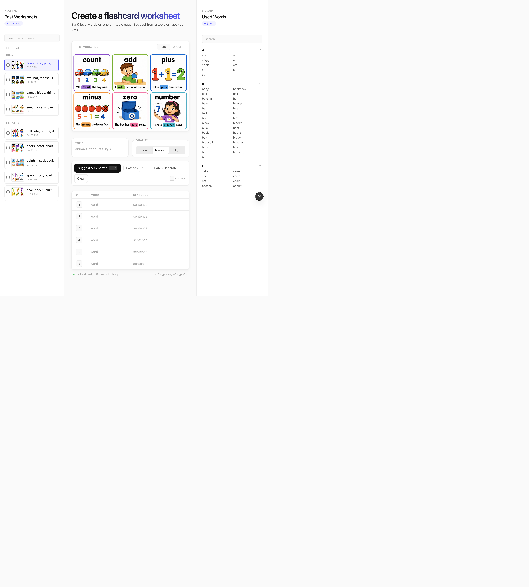

# kidlearn

A local web app for making printable Kindergarten worksheets in **English** or
**simplified Chinese with Mandarin pinyin**. Choose **Flashcard** for a 3×2 grid
of illustrated vocabulary cards, or **GT Thinking** for reasoning questions with
a matching answer key. Both modes support single-sheet and batch generation.

Two OpenAI models are used:

| Model | Purpose |
|---|---|
| `gpt-image-2` | Renders the 1536×1024 worksheet PNG |
| `gpt-5.5` | Suggests vocabulary and GT panel specs, checks image object counts, and revises GT prompts |

There are two worksheet types: **Flashcard** (the original) and **GT Thinking** —
Kindergarten gifted-and-talented reasoning sheets. Switch between them in the web
app's header tabs.



## Features

- **Worksheet language** — choose English or 简体中文 + 拼音 for either mode.
  Chinese pages include pinyin above child-facing text; app controls stay English.
- **Suggest from a topic** — type a theme (animals, food, weather) or leave it
  blank to let `gpt-5.5` pick a coherent set of 6 K-level words.
- **One-click generate** — six (word, sentence) pairs in, one PNG worksheet out.
- **Batch mode** — generate N worksheets in a row, each on a fresh topic-coherent
  set with no word reuse.
- **No-repeat library** — every used word is recorded in `used_words.json`; the
  suggester is told to avoid them, and a 409 conflict is returned if you try to
  reuse one manually.
- **Quality control** — Low / Medium / High maps to the image model's quality
  setting (cost/quality tradeoff).
- **Archive sidebar** — every previously generated worksheet, grouped by day,
  searchable by any of its six words. Multi-select to delete (which releases the
  words back to the library).
- **Print-ready** — each worksheet fits a single US Letter page (landscape,
  0.25" margins, `object-fit: contain`) so the browser print dialog produces
  exactly one sheet per worksheet.
- **GT Thinking mode** — switch to "GT Thinking" for gifted-and-talented reasoning
  sheets: an LLM designs 4–6 themed reasoning panels (4 by default), such as
  odd-one-out, patterns, analogies, and matrices, for a chosen **test focus** (General GT, CogAT, NNAT,
  OLSAT, or a custom test name), and `gpt-image-2` renders a **front** (questions)
  and **back** (answer key) image pair that print as two pages. GT sheets are
  freshly generated each time and don't use the no-repeat word library.
- **GT image checks** — each side is checked for object-count mismatches. Failed
  checks trigger prompt revision and a redraw, up to three render attempts per
  side. The UI shows live progress; batches retain worksheets completed before a failure.
- **Mobile GT history** — use “Show GT history” to reopen or delete saved pairs
  on smaller screens.

## Worksheet languages

Choose **English** (default) or **简体中文 + 拼音** in the worksheet language selector.
Both Flashcard and GT Thinking support simplified Chinese, with tone-mark Mandarin
pinyin above child-facing text. The app controls remain English. Topics may be
entered in English or Chinese; Chinese flashcards can also be edited manually.

To make a Chinese worksheet:

1. Choose **简体中文 + 拼音** in **Worksheet language**.
2. Enter a topic, or leave it blank for suggestions.
3. In GT Thinking, choose a test focus and 4–6 panels. In Flashcard, optionally
   enter your own Chinese words and sentences.
4. Click **Suggest & Generate** (or **Generate** for completed flashcard rows),
   or set **Batches** and click **Batch Generate**.
5. Review the result, then print the sheet or GT questions and answer key.

The language selector is disabled during generation. Changing it clears editable
flashcard text and current previews, while keeping GT test focus and panel settings.
Opening a saved worksheet does not change the language selected for new worksheets.

Pinyin is added by the image model during rendering, so it is not a separate editable
field. Review the rendered characters and pronunciation before printing; GT image
verification checks object counts, not spelling or pinyin accuracy.

Saved worksheets include language badges; existing archives without language metadata
are treated as English. Chinese vocabulary is recorded in the same no-repeat library.

The flashcard suggest/generate/batch and GT suggest/batch APIs accept optional
`language: "en" | "zh-CN"`, defaulting to `"en"`. GT specs carry `language`, and
`/api/gt/generate` uses the language stored in its spec. Older specs default to English.

## Quickstart

```bash
make install                          # backend + frontend deps
echo "OPENAI_API_KEY=sk-..." > .env   # your OpenAI key
make dev                              # starts backend + frontend, Ctrl+C stops both
```

Then open http://localhost:3000.

Other useful targets: `make backend`, `make frontend`, `make stop`, `make test`,
`make e2e`. Run `make help` for the full list.

## Architecture

```
worksheet_common.py  Shared image-production helper: the gpt-image-2 call plus
                     stub-env handling, used by both flashcard_lib and gt_lib.

worksheet_language.py  Shared language values, validation, and Chinese/pinyin
                       rendering instructions.

flashcard_lib.py   Pure Python: prompt template, OpenAI calls (image + vision +
                   chat), file-locked used_words.json read/write, sidecar
                   metadata, batch + backfill.

gt_lib.py          GT worksheets: test profiles/catalogs, spec suggestion,
                   front/back prompt rendering, two-image pair generation,
                   verification/retry loop, batch + list + delete.

server/main.py     FastAPI app — thin wrapper around flashcard_lib and gt_lib.
                   Mounts /generated/* as static files.

server/generated/  Output directory:
                     image-<firstWord>.png   a flashcard worksheet
                     image-<firstWord>.json  sidecar { "words": [...6], "language": "en" | "zh-CN" }
                     gt-<id>-front.png        a GT worksheet (questions)
                     gt-<id>-back.png         the matching answer key
                     gt-<id>.json             GT manifest { spec, theme, test, language, … }

used_words.json    The flashcard library. Single source of truth, fcntl-locked.

web/               Next.js 16 (App Router) + Tailwind v4 + TypeScript.
                   Vitest + RTL + MSW for unit tests; Playwright for E2E.
```

## API

| Method | Path | Purpose |
|---|---|---|
| `GET`  | `/api/used-words`         | All recorded words |
| `POST` | `/api/suggest`            | `{topic, language?}` → 6 (word, sentence) pairs |
| `POST` | `/api/generate`           | `{items[6], quality, language?}` → image URL (409 on word conflict) |
| `POST` | `/api/batch`              | `{topic, n, quality, language?}` → N image URLs |
| `GET`  | `/api/generated`          | Archive listing with all 6 words and language per worksheet |
| `POST` | `/api/generated/backfill` | Extract words from older PNGs via vision and write sidecars |
| `POST` | `/api/generated/delete`   | Delete worksheets and release their words back to the library |
| `POST` | `/api/gt/suggest`         | `{topic, test, panels?, language?}` → a 4–6-panel GT spec with answers (502 on failure) |
| `POST` | `/api/gt/generate`        | `{spec, quality}` → streamed NDJSON progress, ending in `{type: "done", pair: {id, front_url, back_url}}` or `{type: "error", message}` (always HTTP 200 once the stream starts) |
| `POST` | `/api/gt/batch`           | `{topic, test, n, panels?, quality, language?}` → streamed NDJSON: one `{type: "done", index, pair}` per completed item, then `{type: "batch_done"}`, or `{type: "error", message}` on partial failure (always HTTP 200 once the stream starts) |
| `GET`  | `/api/gt/generated`       | GT archive listing (id, theme, test, language, front/back URLs) |
| `POST` | `/api/gt/generated/delete`| `{ids}` → delete GT worksheet pairs by id |

## Tests

```bash
uv run pytest             # backend: lib + server
cd web && npm test        # frontend: Vitest + RTL + MSW
cd web && npm run e2e     # Playwright (flashcard generation stubbed)
```

The flashcard E2E suite sets `FLASHCARD_STUB_IMAGE` and
`FLASHCARD_STUB_SUGGEST` to local fixtures for image generation and vocabulary
suggestions.

## Environment variables

| Variable | Purpose |
|---|---|
| `OPENAI_API_KEY` | Required for real image / suggest / vision calls |
| `FLASHCARD_STUB_IMAGE` | Path to a PNG used instead of calling the image model |
| `FLASHCARD_STUB_SUGGEST` | Path to a JSON fixture used instead of calling the suggest model |
| `FLASHCARD_STUB_EXTRACT` | Path to a JSON fixture used instead of calling the vision model (backfill) |
| `GT_STUB_SPEC` | Path to a JSON fixture used instead of calling the GT spec-suggest model |
| `GT_STUB_IMAGE` | Path to a PNG used instead of calling the image model for GT front/back pairs |
| `GT_STUB_VERIFY` | Path to a JSON fixture containing one verification result or a list indexed by render attempt, used instead of the GT vision check |
| `NEXT_PUBLIC_API_URL` | Frontend's backend base URL (default `http://localhost:8000`) |

## CLI mode

```bash
uv run python generate_flash_cards.py
```

Generates a worksheet from the hard-coded list in that file. Output path is
`server/generated/image-<first-word>.png`. Errors if any word is already used.
